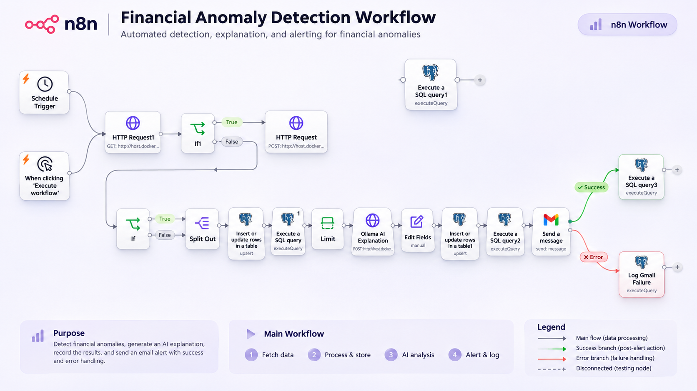
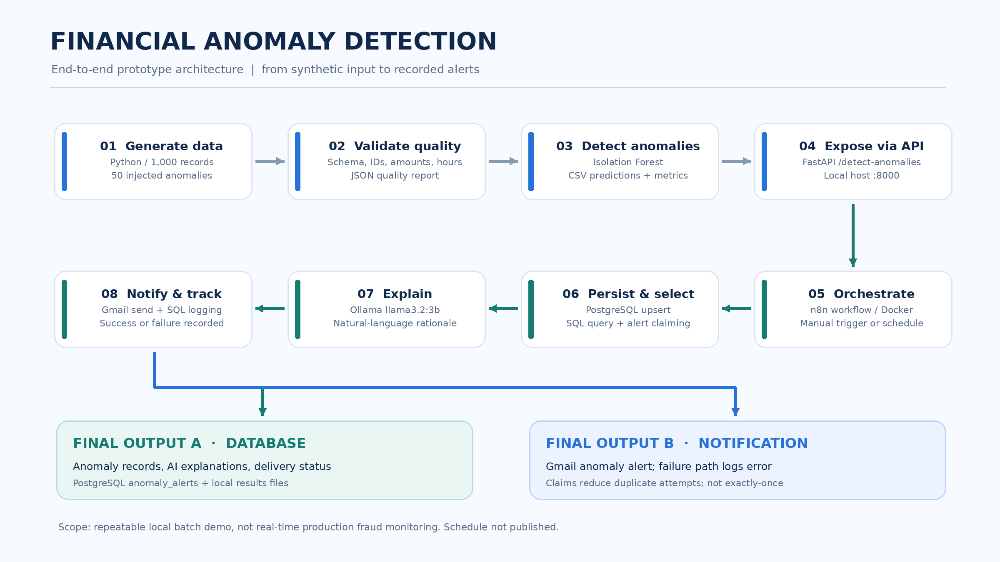

# AI-Powered Financial Transaction Anomaly Detection

An automated financial transaction anomaly detection prototype built using Python, Isolation Forest, FastAPI, PostgreSQL, n8n, Ollama, and Gmail.

## Project Overview

This project processes a synthetic financial transaction dataset, identifies anomalous transactions, generates AI explanations, stores alerts in PostgreSQL, and sends email notifications through n8n.


## n8n Workflow Architecture



The workflow orchestrates transaction processing, PostgreSQL storage,
AI-generated anomaly explanations using Ollama, and Gmail alerts
with success and failure logging.

## Project Documentation

This repository contains a complete technical report, project presentation, and end-to-end architecture diagram for the AI-powered financial transaction anomaly detection pipeline.

### Architecture Diagram



### Documentation and Presentation

- [Complete Project Documentation (PDF)](docs/Financial_Anomaly_Detection_Project_Documentation.pdf)
- [Project Presentation (PowerPoint)](docs/Financial_Anomaly_Detection_Project_Presentation.pptx)
- [n8n Workflow JSON](workflows/financial-anomaly-final-v1.json)

### End-to-End Workflow

1. Generate 1,000 synthetic financial transactions.
2. Validate dataset quality and integrity.
3. Detect anomalies using Isolation Forest.
4. Expose anomaly results through FastAPI.
5. Orchestrate processing using n8n.
6. Save transaction and alert records to PostgreSQL.
7. Generate AI explanations with Ollama.
8. Send Gmail alerts and record delivery success or failure.

**Final outputs:** PostgreSQL transaction/alert records and Gmail notifications with delivery status tracking.

**Note:** This project uses synthetic batch data and is not a production real-time fraud detection system.

## Technology Stack

- Python and Pandas
- Scikit-learn (Isolation Forest)
- FastAPI and Uvicorn
- PostgreSQL
- n8n
- Ollama (Llama 3.2 3B)
- Gmail API
- Docker

## Architecture

Transaction CSV
    |
    v
Python Data Quality Checks
    |
    v
Isolation Forest
    |
    v
FastAPI + n8n
    |
    v
PostgreSQL
    |
    v
Ollama AI Explanation
    |
    v
Gmail Notification

## Model Evaluation

| Metric | Result |
|---|---|
| Total transactions | 1,000 |
| Detected anomalies | 50 |
| Precision | 0.980 |
| Recall | 0.980 |
| F1 Score | 0.980 |

Metrics were calculated against synthetic anomaly labels on the same dataset used to fit the model. They do not represent performance on unseen financial transactions.

## Features

- Automated data quality validation
- Isolation Forest anomaly detection
- REST API integration with FastAPI
- n8n workflow orchestration
- PostgreSQL alert storage
- AI-generated anomaly explanations
- Gmail email alerts
- Duplicate-notification claim tracking
- Gmail success and failure branches

## Local Setup

1. Install Python and Docker Desktop.
2. Install and configure n8n, PostgreSQL, and Ollama.
3. Create a Python virtual environment.
4. Install dependencies:

   pip install -r requirements.txt

5. Start FastAPI:

   uvicorn src.api:app --reload --port 8000

6. Import the exported n8n workflow.
7. Configure PostgreSQL and Gmail credentials.
8. Test the workflow manually before enabling scheduling.

## n8n Integration Configuration

The automation uses Docker-hosted n8n and PostgreSQL, a local FastAPI service, and Ollama for AI-generated anomaly explanations.

### Local service endpoints

| Service | Endpoint |
|---|---|
| n8n editor | `http://localhost:5678` |
| FastAPI | `http://localhost:8000` |
| Anomaly detection API | `http://host.docker.internal:8000/detect-anomalies` |
| Ollama from Docker | `http://host.docker.internal:11434/api/generate` |

`host.docker.internal` allows the n8n Docker container to communicate with services running on the host Mac.

### Start the Python API

Activate the virtual environment and start FastAPI:

```bash
source .venv/bin/activate
uvicorn src.api:app --reload --port 8000
```

### Import and configure the workflow

1. Start Docker Desktop, n8n, PostgreSQL, and Ollama.
2. Open the n8n editor at `http://localhost:5678`.
3. Import `workflows/financial-anomaly-final-v1.json`.
4. Configure the PostgreSQL credential using the database service's hostname, port, database, username, and password.
5. Configure the Gmail OAuth credential and replace the exported recipient placeholder with your intended notification address.
6. Confirm that Ollama has the `llama3.2:3b` model available.
7. Execute the workflow manually and inspect the PostgreSQL and Gmail branches before enabling automatic scheduling.

### Scheduling and delivery limitations

The workflow supports daily scheduling, but the published project does not claim that live scheduling is enabled. Because the prototype processes a static dataset, repeatedly running it can reprocess the same transactions. Email claiming reduces duplicate attempts, but exactly-once delivery is not guaranteed.

This is a local demonstration pipeline, not a production-ready financial monitoring service.

## Limitations

- Processes a static synthetic CSV dataset.
- Model is retrained on the input dataset for each detection run.
- Isolation Forest scores are not fraud probabilities.
- AI explanations may require additional context to support their claims.
- Exactly-once email delivery is not guaranteed.
- Automatic scheduling requires the local services to remain running.

## Future Improvements

- Live transaction ingestion
- Model evaluation on unseen data
- Monitoring dashboard
- Automated recovery and retry handling
- Cloud deployment

## Project Status

Functional local batch-processing prototype.
## Reproduce the Python Pipeline

### Installation

```bash
git clone https://github.com/durgapbattula-sys/ai-financial-anomaly-detection-n8n.git
cd ai-financial-anomaly-detection-n8n
python3 -m venv .venv
source .venv/bin/activate
python -m pip install -r requirements.txt
```

### Run the Pipeline

```bash
python src/generate_data.py
python src/data_quality.py
python src/anomaly_detection.py
```

### Expected Outputs

- `data/transactions.csv` — Generated synthetic transactions
- `results/data_quality_report.json` — Data quality report
- `results/anomaly_predictions.csv` — Anomaly predictions

### Validated Results

| Metric | Result |
|---|---:|
| Synthetic transactions | 1,000 |
| Injected anomalies | 50 |
| Detected anomalies | 50 |
| Data quality issues | 0 |
| Precision | 0.980 |
| Recall | 0.980 |
| F1 score | 0.980 |

These results were measured against synthetic labels and do not establish real-world fraud detection performance.

The Python pipeline can run independently. The complete n8n workflow additionally requires n8n, PostgreSQL, Ollama, FastAPI, and configured Gmail credentials.
